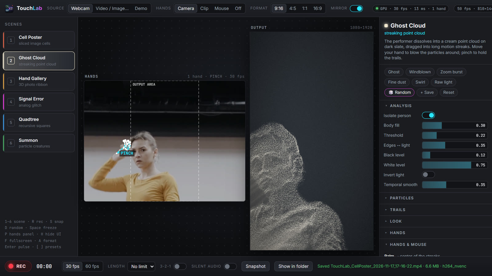
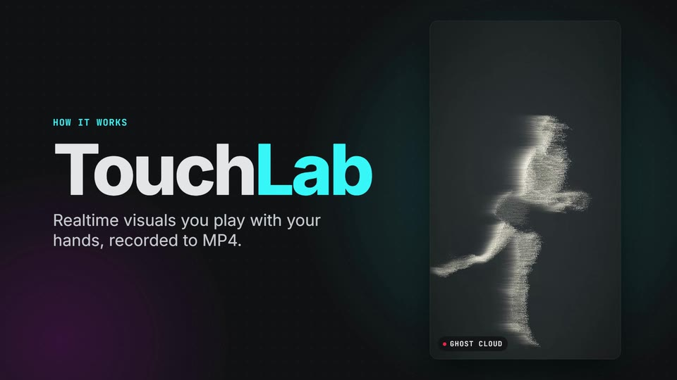
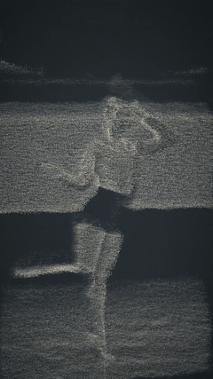
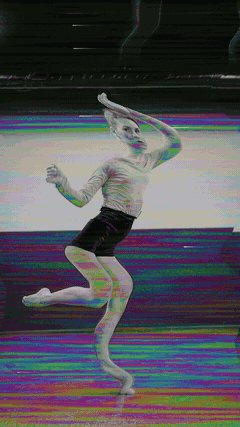
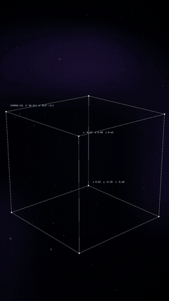
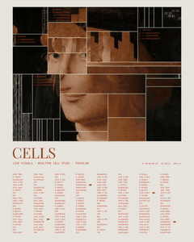
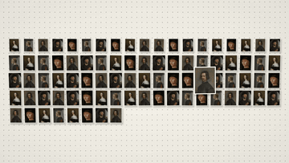
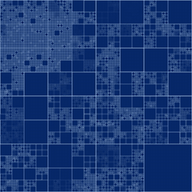

# TouchLab

Realtime visuals you play with your hands. Pick one of six scenes, steer it with your hands on the webcam (or with
the mouse), shape it with sliders and presets, and record vertical, square or wide MP4s.

**Everything runs on your computer. No account, no API key, nothing is uploaded.**

Inspired by TouchDesigner reels by [Ivan Puñal García](https://www.instagram.com/reel/Dd3xqY3ifIS/),
[Julián](https://www.instagram.com/reel/Dd1iWqoviZy/), nayana, Nicklas Mathews, Simon Alexander-Adams and
[william](https://www.instagram.com/reel/DaVd7Gkuo4G/). TouchLab is an independent project, not affiliated with them
or with Derivative (the makers of TouchDesigner), and shares no code with them.



<!-- videos:start -->
## See it in action

<p align="center"><a href="docs/videos/tutorial.mp4"></a><br><b>▶ <a href="docs/videos/tutorial.mp4">How it works</a></b> (0:58, with captions)</p>

**Made with TouchLab, from a free Pexels clip and public-domain portraits (The Met)**

<table><tr>
<td width="33%" align="center"><a href="docs/videos/examples/dancer-ghost-cloud.mp4"></a><br><a href="docs/videos/examples/dancer-ghost-cloud.mp4">Ghost Cloud</a></td>
<td width="33%" align="center"><a href="docs/videos/examples/dancer-signal-error.mp4"></a><br><a href="docs/videos/examples/dancer-signal-error.mp4">Signal Error</a></td>
<td width="33%" align="center"><a href="docs/videos/examples/summon-creatures.mp4"></a><br><a href="docs/videos/examples/summon-creatures.mp4">Summon (mouse as a hand)</a></td>
</tr><tr>
<td width="33%" align="center"><a href="docs/videos/examples/portraits-cell-poster.mp4"></a><br><a href="docs/videos/examples/portraits-cell-poster.mp4">Cell Poster, 4:5</a></td>
<td width="33%" align="center"><a href="docs/videos/examples/portraits-hand-gallery.mp4"></a><br><a href="docs/videos/examples/portraits-hand-gallery.mp4">Hand Gallery, 16:9</a></td>
<td width="33%" align="center"><a href="docs/videos/examples/quadtree-blueprint.mp4"></a><br><a href="docs/videos/examples/quadtree-blueprint.mp4">Quadtree Blueprint, 1:1</a></td>
</tr></table>

Click any picture to play the video. Example sources: "A Woman Dancing Gracefully" by [Pavel Danilyuk](https://www.pexels.com/video/a-woman-dancing-gracefully-6939968/) (Pexels licence); portraits by Antonello da Messina, Giovanni di Francesco, Adriaen Hanneman, Velázquez and Hugo van der Goes, [The Met](https://www.metmuseum.org/) (CC0, see [samples/CREDITS.md](samples/CREDITS.md)). Summon and Quadtree draw everything themselves, steered by the mouse.
<!-- videos:end -->

## Install

You need:
- Windows 10 or 11 (it is built and tested on Windows 11)
- [Node.js](https://nodejs.org) 22.12 or newer
- [ffmpeg](https://ffmpeg.org/download.html) on your PATH, for MP4 export (`winget install Gyan.FFmpeg`)
- Google Chrome or Microsoft Edge, and a webcam if you want to use your hands
- Optional: [Python](https://www.python.org/downloads/) with Pillow, only to redraw the icon

```
npm install
npm run build
npm start
```

Then open http://127.0.0.1:4747/ in Chrome or Edge. `npm install` also copies MediaPipe's runtime into `public\` and
downloads the hand-tracking and person-mask models from Google once (about 8 MB, each file checked against its
SHA-256). After that, the app never goes online. If the download was interrupted, run `npm run setup-assets`.

Or double-click **Setup.cmd**: it installs, builds, draws the icon and puts a **TouchLab** shortcut on your Desktop
and in the Start menu. The shortcut starts the local server without a console window and opens the app in its own
Edge (or Chrome) window. The server quits by itself about 20 seconds after the last window closes, never while a
recording is being converted.

## Scenes

| Key | Scene | What you do |
|---|---|---|
| 1 | Cell Poster | Load 1 to 4 of your own pictures; they are sliced into drifting, smeared cells on an editorial poster. Pinch reshuffles or brings the next picture |
| 2 | Ghost Cloud | Your camera or video becomes a streaking cream point cloud; your palm is the wind, a pinch holds the trails |
| 3 | Hand Gallery | A 3D ribbon of photo cards (built-in drawings, or your own pictures). Swipe, zoom and grab cards; click one to open it full-frame |
| 4 | Signal Error | Analog rainbow and sync-tear glitches on your camera, video or picture; pinch for signal loss |
| 5 | Quadtree | Recursive squares, clean or wobbly; your fingertips pull in detail, a pinch freezes time |
| 6 | Summon | Pinch the air to summon glowing particle creatures (lily, jellyfish, koi, phoenix, galaxy, your own PNGs…); open your hand to dissolve them |

Each scene's panel on the right lists its gestures under **Hands & mouse**.

- **Presets**: each scene has built-in presets (the chips at the top of the right panel) and a **🎲 Random** button
  (or `D`) for a new look. Save your own with **+ Save** or Ctrl+S; right-click your preset to delete it.
  **Export presets** / **Import presets** back them up as a JSON file.
- **Sliders**: drag anywhere on a slider to set it, use the wheel to nudge it, double-click to reset it, right-click
  to type a value.
- **Your pictures**: Cell Poster, Hand Gallery and Summon show **Images → Add images…** in the top bar and an image
  strip in the right panel. You can also drag files onto the stage; hover a thumbnail to remove it. Each scene keeps
  its own pictures between sessions. JPG, PNG and WebP work; iPhone HEIC photos need converting first. The
  `samples\` folder has five public-domain portraits to try.

## Two panels

The stage shows two panels side by side: **HANDS** (your camera; the header shows how many hands are tracked and their
gesture, and **View & input → Tracking lines** draws the tracked skeleton) and **OUTPUT** (only the effect: this is what
gets recorded). `P` hides or shows the hands panel, `G` also draws the hands over the output preview (never recorded),
and `F` puts the output alone in full screen.

## Sources and hands

- **Source** (Ghost Cloud, Signal Error, Quadtree, Summon's camera background): Webcam, a video or picture file (also
  by drag and drop onto the stage), or the built-in **Demo** performer. Cell Poster and Hand Gallery use their own
  pictures.
- **Hands**: Camera (MediaPipe hand tracking on the webcam), Clip (tracks hands inside the loaded video), Mouse, or
  Off. When no hand is visible, holding a mouse button on the output acts as a hand (left = pinch, right = fist); just
  hovering does nothing. With Hands = Mouse the cursor is always a hand (move = fingertip, Alt = point, wheel = rotate,
  Ctrl+wheel = hand size).
- Hand tracking runs in a background worker on the GPU (about 20 to 30 frames a second) and falls back to the CPU if
  the GPU can't start. You can switch it under **View & input → Tracker**.

## Recording

Press **REC** (or `R`; `Shift+R` starts with a 3-2-1 countdown). Recording always renders at full resolution:
1080×1920 for 9:16, 1080×1350 for 4:5, 1080×1080, or 1920×1080. When you stop, the local server converts it with
ffmpeg (NVIDIA's NVENC encoder when your GPU has one) to an H.264 High MP4: yuv420p, constant 30 or 60 fps, bt709
colours, fast start. **Silent audio** adds an empty sound track for apps that want one, and **Length** stops the
recording by itself. **Snapshot** (`S`) saves a PNG of the output. Keep the window visible while recording: browsers
pause hidden windows.

Files go to `Videos\TouchLab` in your user folder, named `TouchLab_<Scene>_<date>_<time>.mp4` (or `.png`); existing
files are never overwritten. **Show in folder** opens the folder. To use another folder, create `config.json` next to
`server.mjs`:

```json
{ "outDir": "D:\\Clips" }
```

## Keys

`1`–`6` scenes · `R` record · `S` snapshot · `D` random look · `Space` freeze · `H` hide UI ·
`F` output full screen · `P` hands panel · `G` hands on output · `M` mirror · `A` format · `C` source ·
`T` crossfade · `Enter` pulse (reshuffle / next object) · `[` `]` presets · `Tab` hands ↔ mouse ·
`Esc` stop / show UI

## What's where

```
touchlab/
├─ server.mjs              local server (Node, no dependencies) on 127.0.0.1:4747: serves dist/, turns recordings
│                          into MP4 with ffmpeg, saves snapshots, opens the output folder. Only this app's own
│                          pages may call it. Set TOUCHLAB_PORT to use another port with npm start.
├─ launch.vbs              launcher: starts the server hidden and opens an Edge or Chrome app window
├─ Setup.cmd               one-step setup: npm install, build, icon, shortcuts
├─ Create Desktop Shortcut.ps1   makes the Desktop and Start-menu shortcuts
├─ index.html, vite.config.ts, tsconfig.json
├─ src/
│  ├─ main.ts              start-up: fonts, scenes, camera, and the test hook (window.__touchlab)
│  ├─ core/                Engine (render loop, formats, crossfade), Params (sliders, presets), Recorder
│  │                       (MediaRecorder), ImageStore (your pictures, in IndexedDB), Api (calls to the server)
│  ├─ input/               Sources (webcam, video, picture, Demo performer) and hands/ (the MediaPipe worker,
│  │                       gestures, One Euro smoothing, mouse as a hand, camera-to-output mapping)
│  ├─ gfx/                 shared WebGL helpers: full-screen passes, render targets, bloom, frame history, GLSL noise
│  ├─ scenes/<id>/         one folder per scene. Each index.ts default-exports a SceneDef (see scenes/types.ts);
│  │                       registry.ts sets the order (keys 1–6). The right panel is built from each scene's
│  │                       parameter list.
│  └─ ui/                  Shell (top bar, scene list, the two panels, record bar, keys), Panel (right panel), styles
├─ public/favicon.png      npm install adds public/mediapipe/ (wasm runtime) and public/models/ (the two models)
├─ assets/                 the app icon (touchlab.ico and PNGs)
├─ scripts/
│  ├─ setup-assets.mjs     runs after npm install: copies the wasm runtime, downloads and checks the models
│  ├─ dev.mjs              npm run dev: the API server plus Vite with hot reload on http://127.0.0.1:4748
│  ├─ smoke.mjs            the end-to-end test (browser.mjs finds Chrome or Edge)
│  ├─ shot.mjs             dev helper: screenshots of scenes in headless Chrome
│  └─ make_icon.py         draws the icon (npm run icon; needs Python and Pillow)
├─ samples/                five public-domain portraits and a 3-second hand clip (see samples/CREDITS.md)
└─ tests/hands.test.ts     unit tests
```

Your data: presets, view settings and your pictures live in the app window's browser profile
(`%LOCALAPPDATA%\TouchLab\EdgeProfile` when you start it with the shortcut). The server writes `logs\server.log`
and keeps a recording in `work\` only while it converts it.

| Command | What it does |
|---|---|
| `npm run dev` | API server on 4747 plus Vite with hot reload on http://127.0.0.1:4748 |
| `npm run build` | Type-check and build into `dist/` (served by `server.mjs`) |
| `npm start` | Run the server on http://127.0.0.1:4747 |
| `npm test` | Unit tests |
| `npm run smoke` | End-to-end test in headless Chrome or Edge (start the server first) |
| `npm run icon` / `npm run shortcut` | Redraw the icon / recreate the shortcuts |

## Tests

```
npm test
npm run build
npm start          (in a second terminal)
npm run smoke
```

- `npm test`: 8 unit tests for the gesture reader (open, fist, pinch, point; scale and rotation; the pinch latch),
  the One Euro smoothing filter and the camera-to-output mapping.
- `npm run smoke`: 36 checks in headless Chrome (or Edge) with a fake webcam that plays `samples\hands.mp4`. It checks
  that the hand tracker finds a hand, every scene renders, animates and looks different, sliders change the picture
  and survive a reload, all four formats have the right size, Cell Poster and Hand Gallery take the sample portraits,
  the Random button and pinch gestures work, and two 4-second recordings become H.264 High 1080×1920 MP4s (checked
  with ffprobe; they are saved in your output folder). The first run converts the hand clip into
  `test-fixtures\hands.y4m` (about 40 MB) with ffmpeg; without ffmpeg the hand checks are skipped. Add `-- --no-record`
  to skip the recordings. Screenshots and a report go to `artifacts\smoke\`. Set `TOUCHLAB_BROWSER` to a browser's
  `.exe` if yours isn't found.

## Credits

- Inspiration: TouchDesigner reels by Ivan Puñal García ([1](https://www.instagram.com/reel/Dd3xqY3ifIS/),
  [2](https://www.instagram.com/reel/DdzM3Iwiek5/)) for Cell Poster, [Julián](https://www.instagram.com/reel/Dd1iWqoviZy/)
  for Ghost Cloud, nayana for Hand Gallery, Nicklas Mathews for Signal Error, Simon Alexander-Adams for Quadtree and
  [william](https://www.instagram.com/reel/DaVd7Gkuo4G/) for Summon.
- Hand tracking and person masks: [MediaPipe Tasks Vision](https://ai.google.dev/edge/mediapipe/solutions/guide)
  (`@mediapipe/tasks-vision`, Apache-2.0) with Google's Hand Landmarker and Selfie Segmenter models (Apache-2.0),
  downloaded from Google's model storage when you install.
- 3D and WebGL: [three.js](https://threejs.org) (MIT).
- Fonts: Inter, JetBrains Mono, Playfair Display and IBM Plex Mono, from [Fontsource](https://fontsource.org)
  (SIL Open Font License 1.1).
- Samples: five portraits from [The Metropolitan Museum of Art](https://www.metmuseum.org/) Open Access program (CC0),
  and a clip from "A Woman Dancing Gracefully" by
  [Pavel Danilyuk](https://www.pexels.com/video/a-woman-dancing-gracefully-6939968/)
  ([Pexels licence](https://www.pexels.com/license/)). See [samples/CREDITS.md](samples/CREDITS.md).
- Footage in the tutorial and examples: the sample portraits above (CC0) and "A Woman Dancing Gracefully" by
  [Pavel Danilyuk](https://www.pexels.com/video/a-woman-dancing-gracefully-6939968/) ([Pexels licence](https://www.pexels.com/license/)).
  In the tutorial, a 3-second clip of it (`samples/hands.mp4`) stands in for the webcam.

## Licence

MIT, see [LICENSE](LICENSE). The MediaPipe models and the fonts keep their own licences (above).
